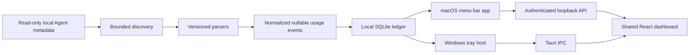

# Architecture

AgentBarBar has one repository and separate native hosts. The dashboard, usage-event schema, privacy rules, and platform-neutral Rust crates are shared. The existing Swift and Rust implementations remain platform-specific where each host depends on them.

## Platform components

- **macOS:** `Sources/AgentBarBarApp/` contains the AppKit/SwiftUI app, `Sources/AgentBarBarCore/` contains discovery, collectors, parsing, storage, aggregation and the local API, and `Sources/AgentBarBarCLI/` contains the development CLI.
- **Windows:** `Windows/src-tauri/` contains the Tauri host and Windows lifecycle/tray code. It uses `Shared/core/` Rust crates for normalized events, storage, parsing and collection. The dashboard is loaded in the local WebView through Tauri IPC.
- **Shared UI and contracts:** `Dashboard/` contains the React/TypeScript interface. `Shared/usage-event.schema.json` defines the normalized event shape and `Shared/migrations/` contains versioned database migrations.

## Collection and normalization

Discovery rules are bounded and separate from usage support. Finding an application or executable is installation evidence; a collector reports source availability separately. Source files and databases are opened read-only. A parser accepts only recognized fields and returns usage metadata, not conversation content.

Each metric is nullable and has an explicit state (`known`, `unknown`, `unsupported`, `not_available`, or `partial`). Input includes cache read/write; output includes reasoning. These overlapping components are not added to the total again. Model/provider identifiers are kept as reported. Aggregates include known-event coverage.

Parsers are versioned. Cursors and database commits support restart-safe incremental import and deduplication. Unsupported schema changes must not be guessed into usage events.

## Local service boundary

The macOS dashboard server binds to loopback and requires a per-launch credential. Static assets and requests are bounded; no CORS is enabled. The Windows host communicates with the bundled dashboard through Tauri IPC. Neither platform exposes the usage ledger to the LAN.
